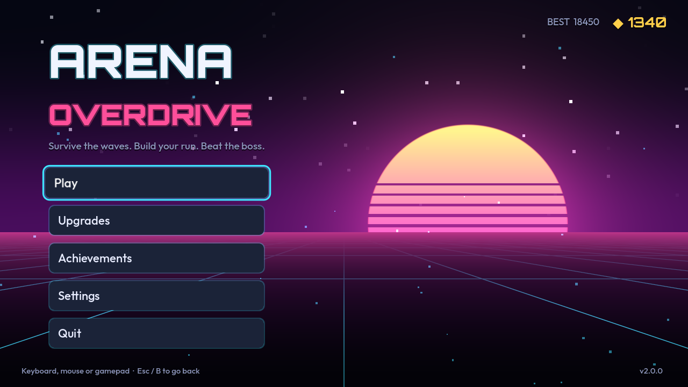
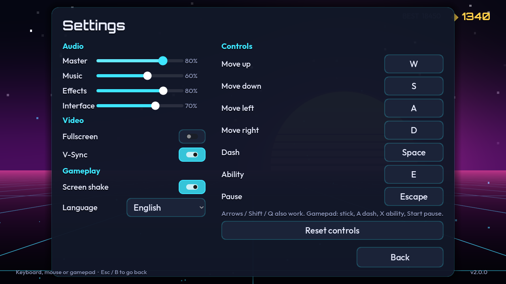
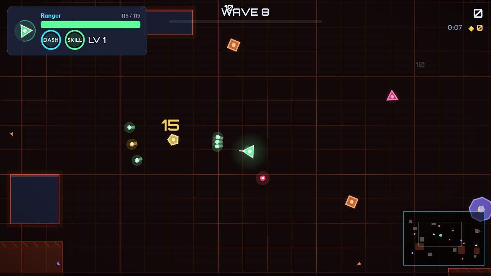
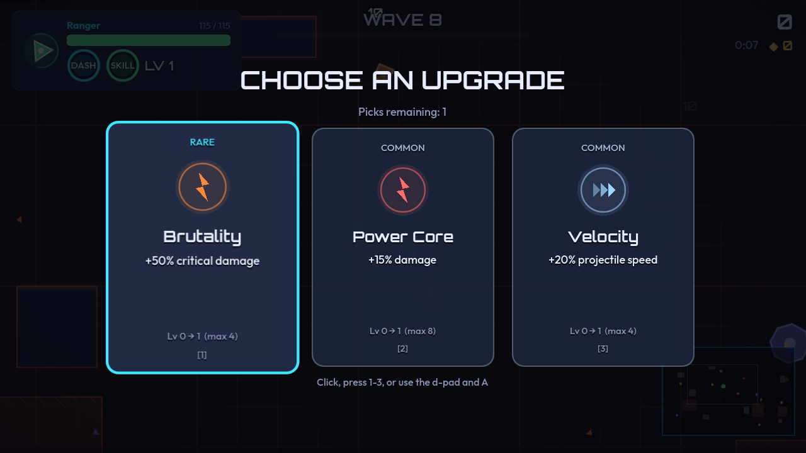
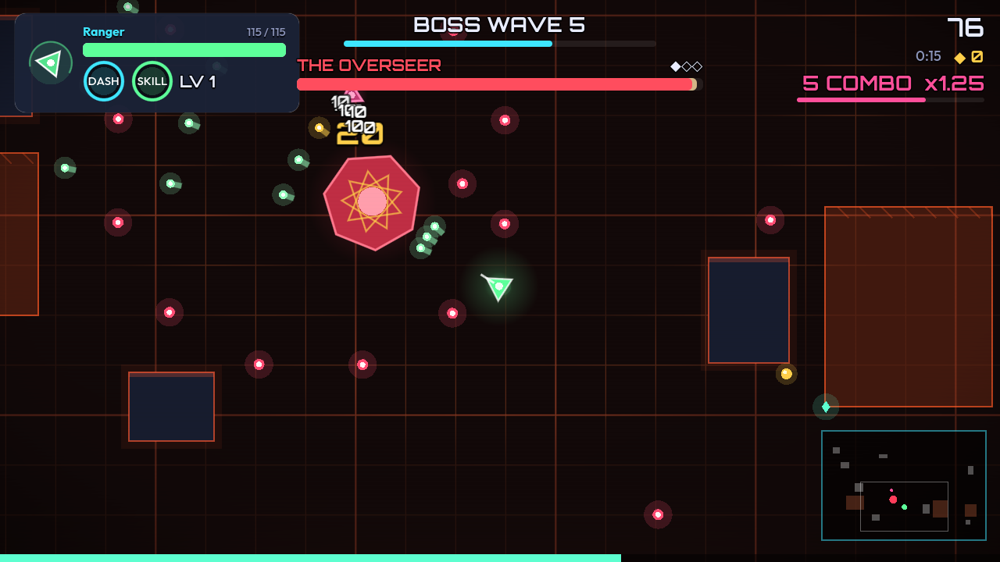
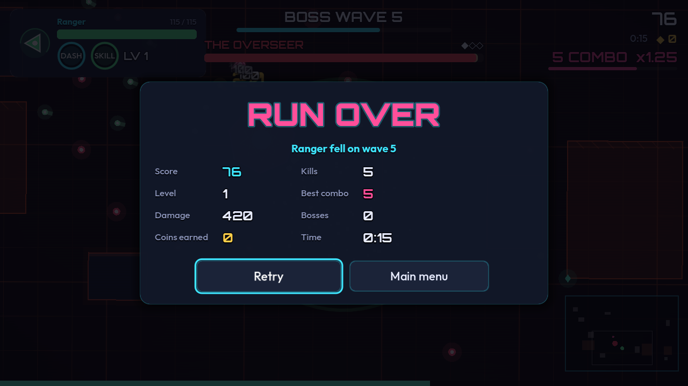
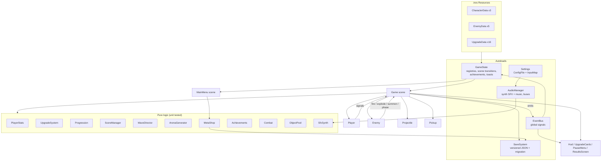

# Arena Overdrive

A top-down **roguelite arena shooter** built in **Godot 4.7** with **typed GDScript**. Pick a class, survive escalating waves, choose 1 of 3 upgrade cards between waves, take down the Overseer boss across three phases, and spend the coins you earn on permanent upgrades.

Every asset is original and generated at runtime: shapes are drawn in code, effects come from shaders and particles, and every sound effect plus the music loop is synthesized in GDScript. The only bundled files are two SIL Open Font License fonts, Outfit and Orbitron (see `assets/fonts/`).

| | |
|---|---|
|  |  |
|  |  |
|  |  |

## Features

**Gameplay**
- **3 playable classes**, each with its own stats, weapon feel and ability:
  - Vanguard: Shockwave knockback blast
  - Ranger: Volley, a ring of 18 piercing bolts
  - Arcanist: Blink Nova, a teleport followed by a detonation
- **5 data-driven enemy types**:
  - Chaser: melee rush
  - Gunner: kites to a set range, strafes and shoots
  - Bulwark: a slow tank that resists knockback
  - Volatile: an exploder with a telegraphed fuse that also damages other enemies
  - The Overseer: a boss with **3 phases** (radial bursts, then faster spirals, then an enraged form that summons adds)
- **Wave director**: each wave gets a point budget, enemy types unlock by wave, health scales up, and every 5th wave is a boss wave.
- **Roguelite upgrades**: after every wave you pick 1 of 3 cards.
  - 16 cards across common, rare and epic rarities, with weighted rolls and stack caps.
  - Leveling up earns an extra pick.
- **Leveling**: enemies drop XP shards, which a magnet pulls in, and the XP curve gets steeper each level.
- **Combat**: auto-aim weapons, multishot, piercing, crits, armor, regen, a dash with i-frames, and ability cooldowns.
- **Procedural arenas**: a seeded layout picks one of 4 themes (Neon Grid, Ember Foundry, Frost Lab, Toxic Bay) and places obstacle pillars and theme hazards: burn zones, slow fields, and pulsing shock grids.
- **Meta-progression**: banked coins buy 6 permanent shop upgrades and unlock classes.
- **10 achievements**, with in-game toasts and progress bars.

**UI/UX**
- **Main menu**: an animated synthwave shader background with drifting particles, plus tweened page transitions to character select, the shop, achievements and settings.
- **Shared theme**: a single theme resource (`ui/theme.tres`, built from `UiTheme`) with hover, press and focus states. Hover and focus look identical, so mouse, keyboard and gamepad users all see the same feedback.
- **Full keyboard and gamepad navigation** in every menu, with explicit focus chains and Esc/B to go back.
- **Settings**, saved to `user://settings.cfg`:
  - master, music, SFX and UI volume
  - fullscreen and V-Sync
  - screen shake toggle
  - language (English or Spanish)
  - **key rebinding**, which swaps keys on conflict and has a reset option
- **HUD**:
  - health bar with a lagging damage trail
  - XP bar
  - wave progress bar
  - boss bar with phase pips
  - combo meter with a decay bar
  - dash and ability cooldown rings
  - **minimap**
  - **off-screen enemy indicators**
  - floating **damage numbers**, with bigger gold numbers for crits
  - level-up and wave banners
- **Pause menu** with in-game settings. The game also auto-pauses when the window loses focus.
- **Results screen** with animated stat count-ups, a new-best badge and the achievements you unlocked.

**Game feel**
- Trauma-based **screen shake** on the camera
- **Hit-stop** that scales with impact (kills, tank and boss deaths, damage taken)
- A white **hit-flash** and a noise **dissolve** on death, both from `flash_dissolve.gdshader`
- **Additive glow** sprites, particle bursts, shockwave rings and dash trails
- A full-screen **vignette and damage flash** shader with a low-health pulse
- A slow-motion death sequence

**Audio**
- `SfxSynth` generates around 20 SFX and a looping synthwave track from oscillators, noise and envelopes.
- Bus layout: `Master > Music, SFX, UI` (`default_bus_layout.tres`).
- A pooled, rate-limited voice system with pitch variation.

## Architecture



```
autoload/      EventBus, SaveSystem, Settings, AudioManager, GameState
data/          characters/*.tres, enemies/*.tres, upgrades/*.tres, strings.csv (en, es)
scenes/        main_menu.tscn, game.tscn, player.tscn, enemy.tscn
scripts/core/  pure gameplay systems (stats, upgrades, XP, score, waves, arena, shop, achievements, pool, synth)
scripts/entities/  Player, Enemy (FSM), Projectile, Pickup, DamageNumber, ArenaView
scripts/fx/    GameCamera (shake), Fx (particles, glow, rings), ShockRing
scripts/ui/    UiTheme, UiKit, Widgets, MainMenu, SettingsPanel, Hud, UpgradeCards, PauseMenu, ResultsScreen
scripts/tools/ build_theme.gd, screenshot_tour.gd, strings_source.py
shaders/       arena_floor, menu_background, flash_dissolve, screen_fx
tests/unit/    GUT test suites
```

Engineering notes:
- **Data-driven content.** Enemies, upgrades and classes are `Resource` scripts saved as `.tres`, so balancing them needs no code changes. `DataRegistry` loads whole folders and is export-safe because it handles `.remap` files.
- **One FSM for every enemy.** `Enemy.evaluate_state()` is a pure function of distance and behavior (`IDLE`, `CHASE`, `ATTACK`, `RETREAT`, `FUSE`, `DEAD`), which makes every archetype's transitions unit-testable. Enemies never spawn bullets themselves. They emit `fire_requested`, `exploded` and `summon_requested`, and the game handles those signals.
- **Object pooling.** Projectiles, pickups, damage numbers and enemies are all recycled through `ObjectPool`. Released nodes are hidden and set to `PROCESS_MODE_DISABLED`, which also removes their physics bodies.
- **Versioned saves.** `SaveSystem.migrate()` upgrades v1 (the original prototype's `high_score` in `highscore.cfg`) to v2 (coins, meta, stats) and then to v3 (achievements, unlocks, boss stats). Saves are written atomically through a temp file, and a corrupt file is backed up before the game starts fresh.
- **Localization.** Every UI string is a key in `data/strings.csv`, which has English and Spanish columns and is imported natively as Godot translations. Static labels retranslate automatically when the language changes.
- **Decoupling.** Gameplay communicates through `EventBus` signals, so the HUD, toasts, camera shake and hit-stop never hold references to gameplay objects.

## Controls

| Action | Keyboard / mouse | Gamepad |
|---|---|---|
| Move | WASD or arrows | Left stick or D-pad |
| Aim and shoot | automatic, targets the nearest enemy | automatic |
| Dash (i-frames) | Space or Shift | A or RB |
| Class ability | E or Q | X or LB |
| Pause | Esc or P | Start |
| Pick an upgrade card | Click, 1-3, or arrows + Enter | D-pad + A |
| Menu back | Esc | B |

All keyboard bindings can be changed in **Settings → Controls**.

## Running

Requires Godot **4.7.x** (built and tested with 4.7.2-stable). The project uses the Compatibility renderer.

```bash
godot --headless --import --path .    # first run: imports the fonts and translations
godot --path .                        # play
```

Or open `project.godot` in the editor and press F5.

Maintenance commands:

```bash
godot --headless --path . -s scripts/tools/build_theme.gd       # rebuild ui/theme.tres from UiTheme
python3 scripts/tools/strings_source.py                          # regenerate data/strings.csv
xvfb-run godot --path . --rendering-driver opengl3 -- --tour=docs   # recapture README screenshots
```

## Tests

There are **128 GUT tests across 11 suites**, using GUT 9.6.1 vendored in `addons/gut`. They cover:
- the player controller (movement, dash, cooldowns, i-frames, armor, regen, firing, abilities)
- the FSM for every enemy archetype, including boss phases and summons
- stats and combat math
- the upgrade card roller (distinct picks, determinism, rarity weighting, stack caps)
- the XP curve and scoring/combo
- the save system (round trip, v1→v3 and v2→v3 migration, legacy import, corrupt-file recovery)
- settings persistence and key rebinding
- the meta shop and achievements
- arena generation invariants
- wave composition
- object pooling, pickups and projectiles
- the audio synth, buses and localization coverage
- data validation
- integration tests that boot the real game scene

```bash
godot --headless --import --path .
godot --headless --path . -s addons/gut/gut_cmdln.gd
```

CI runs the same commands on every push and pull request (`.github/workflows/tests.yml`).

## License

The code is MIT, see [LICENSE](LICENSE). The fonts are under the SIL OFL 1.1, see `assets/fonts/*-OFL.txt`. GUT is MIT-licensed by its authors.
