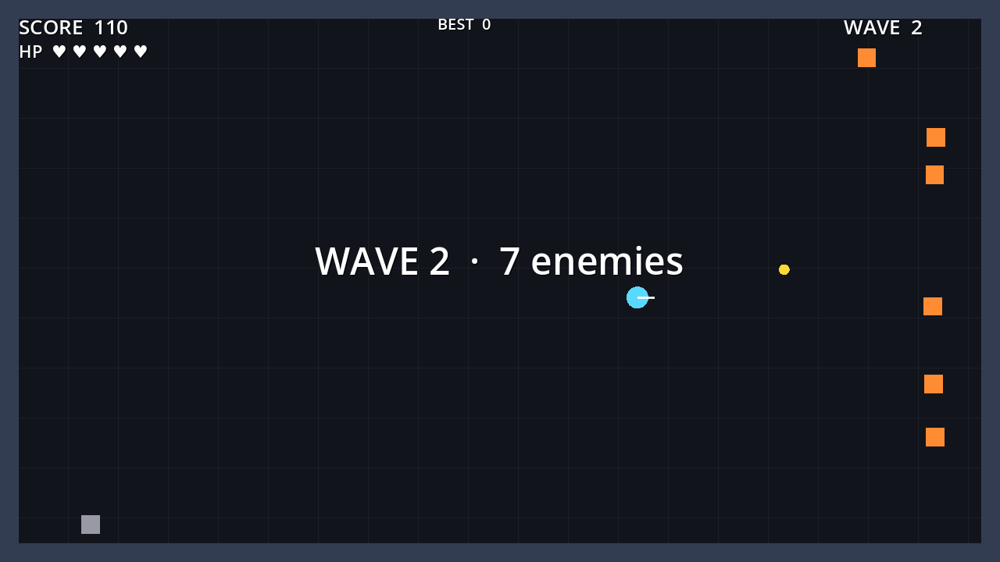
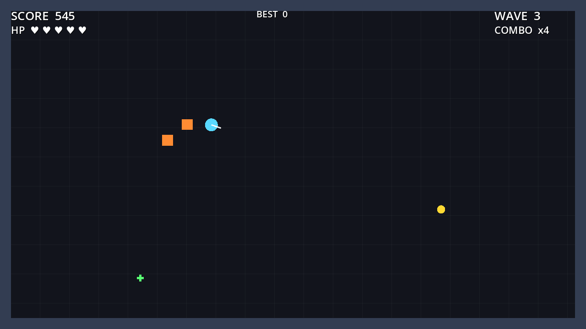
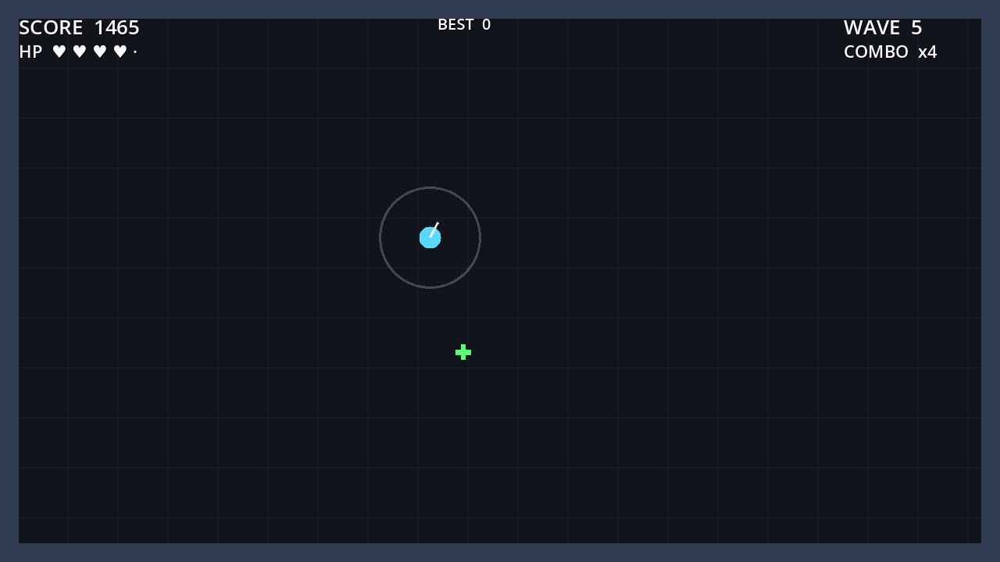

# Godot Arena

A small top-down 2D arena survival game built in **Godot 4** with **typed GDScript**. Survive escalating waves of enemies, chain kills into combos, grab pickups, and beat your saved high score.

All visuals are drawn with Godot's built-in 2D drawing API (no external art assets), so the project is tiny and fully self-contained.





## Controls

| Action | Keys |
|---|---|
| Move | WASD or arrow keys |
| Dash (brief i-frames, cooldown) | Shift or Space |
| Melee strike (radial) | J, K or left mouse |
| Restart after game over | R or Enter |

## Systems implemented

- **Player controller**: 8-way normalized movement, a dash with its own duration and cooldown (with a cooldown ring shown on the player), invulnerability frames after hits and during dashes, and a radial melee attack with a cooldown.
- **Enemy AI**: a finite state machine (`IDLE → CHASE → ATTACK`) with a leash/hysteresis range so enemies don't flicker between states, an attack cooldown, and a `state_changed` signal. Color shows the current state (grey idle, orange chase, red attack).
- **Wave spawner**: enemies spawn on the arena edge, with per-wave scaling of count, speed and health and a short delay between waves.
- **Scoring**: kill points with a combo multiplier (up to x4) that resets after 2 seconds without a kill.
- **Pickups**: enemies have a chance to drop health or bonus-score pickups, which time out if not collected.
- **HUD and game flow**: score, HP, wave, combo, best score, wave banners, and a game-over panel with restart.
- **Persistence**: the high score is saved to `user://highscore.cfg` with `ConfigFile`, and corrupted values fall back to 0.
- **Demo/autopilot mode**: a scripted bot that plays the game, used for smoke tests and for capturing the screenshots above.

## Architecture

```
scenes/   main.tscn, player.tscn, enemy.tscn, pickup.tscn, hud.tscn
scripts/  main.gd           game controller; wires all systems together through signals
          player.gd         Player (CharacterBody2D)
          enemy.gd          Enemy FSM (CharacterBody2D)
          wave_spawner.gd   WaveSpawner (Node)
          pickup.gd         Pickup (Area2D)
          score_manager.gd  ScoreManager (RefCounted, pure logic)
          high_score_store.gd HighScoreStore (RefCounted, ConfigFile I/O)
          hud.gd            Hud (CanvasLayer)
          input_setup.gd    registers key bindings at runtime
          game_config.gd    shared constants and physics layers
tests/    GUT unit tests
addons/   vendored GUT (Godot Unit Test)
```

Design choices:
- **Logic is kept separate from engine callbacks.** `Player.step()`, `Enemy.evaluate_state()` / `Enemy.tick()` and `ScoreManager` can run deterministically without a running physics frame, which makes them easy to unit test.
- **Systems talk through signals.** For example `health_changed`, `died`, `attacked`, `state_changed`, `wave_started` and `score_changed`, so no system holds hard references to the HUD.
- **Physics layers** (player, enemies, walls, pickups) are named in `project.godot` and set in code, so collisions are explicit.

## Running

Requires Godot 4.x (built and tested with 4.7.2).

```bash
godot --path .                          # play
godot --path . -- --demo                # watch the autopilot play
godot --path . -- --screenshot=docs     # autopilot run that saves 3 screenshots, then quits
```

Or open `project.godot` in the editor and press F5.

## Tests

The tests use [GUT](https://github.com/bitwes/Gut) 9.6.1, vendored in `addons/gut`. They cover:

- player movement, diagonal clamping, the dash (speed, facing fallback, cooldown blocking and recovery, signal), damage, i-frames, death, healing, and attack cooldown
- enemy FSM transitions (idle, chase, attack, back to idle), the hysteresis leash, signal parameters, attack damage and cooldown, ignoring dead targets, and the death signal
- scoring and combo math, combo decay, wave scaling, and pickups
- high-score save/load round trip, record-only submission, a missing file, and a corrupt file

Run them headless:

```bash
godot --headless --import --path .      # first run only: builds the class cache
godot --headless --path . -s addons/gut/gut_cmdln.gd
```

CI runs the same command on every push and pull request (see `.github/workflows/tests.yml`).

## License

MIT, see [LICENSE](LICENSE). GUT is MIT-licensed by its authors (see `addons/gut/LICENSE.md`).
